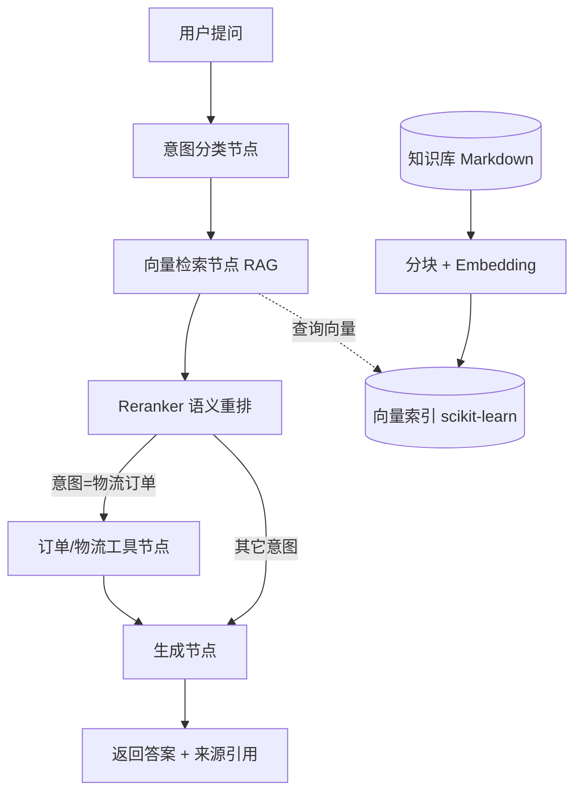

# 基于 Agent 的电商智能客服系统 · 技术报告

> 项目类型：课程 / 个人项目（数据科学与大数据技术）
> 技术栈：Python · LangGraph · scikit-learn (NearestNeighbors) · 通义千问 / DeepSeek / 豆包 / 小米 MiMo · FastAPI
> 关键词：RAG、向量检索、Reranker 重排序、Agent 编排、意图分类、检索评测、数据可视化

---

## 1. 项目背景与问题

传统电商客服面临两大痛点：**人力成本高**、**回答不一致**。基于大模型的客服虽有通用能力，但直接"裸用"会出现**幻觉**（编造不存在的退换货政策、错误价格），且无法执行**业务动作**（查订单、改地址）。

本项目目标是构建一个 **"检索增强 + 工具调用"** 的客服 Agent：让回答 **有据可依**（来自知识库），并能在适当时机 **调用业务工具**，从而兼顾准确性与实用性。

## 2. 系统架构

- **知识库**：商品、售后、FAQ、物流、平台政策等结构化 Markdown 文档。
- **检索层**：文档按二级标题分块 → Embedding → 写入向量索引（scikit-learn `NearestNeighbors`，Windows 友好），查询时**先多召回一批候选，再经 Reranker 重排**精选 Top-N。
- **Agent 层**：LangGraph 状态图编排「分类 → 检索 → 重排 → 工具 → 生成」。
- **接口层**：FastAPI 提供 `/api/chat` 与 `/dashboard`，前端单页聊天界面 + 意图分布看板。

## 3. RAG 检索管线设计

| 环节 | 方案 | 说明 |
|------|------|------|
| 文档切分 | 按 `##` 二级标题分块 + 滑动窗口 | 块大小 400 字、重叠 80 字，保证语义完整 |
| 向量化 | 通义千问 `text-embedding-v3`（1024 维） | 中文语义强；无 Key / 非 qwen provider 时降级为本地 hash 向量 |
| 索引 | scikit-learn `NearestNeighbors`（余弦） | 纯 Python 依赖、Windows 可直接安装，替代 FAISS |
| 召回 + 重排 | 多召回 8 候选 → Reranker 精选 4 | 缓解"召回了但不相关"的噪声 |

**降级策略**：当未配置 API Key 时，Embedding 自动切换为本地哈希词袋向量，生成切换为模板拼接——保证项目**零成本可运行、可演示**；接入真实 Key 后无需改代码即升级为语义检索。豆包文本 Embedding 已下线、小米无公开 Embedding，故二者默认走本地 hash 兜底，可单独配置通义 Key 升级语义检索。

## 4. Agent 编排（LangGraph）

状态图 `AgentState` 维护 `messages / query / intent / context / sources / order_info / answer`。节点流转：

1. **classify**：LLM（或直接规则）将问题分为 `售前咨询 / 售后问题 / 物流订单 / 投诉建议 / 闲聊`。
2. **retrieve**：向量检索多召回候选 → **Reranker 语义重排**精选 Top-N，产出上下文与来源。
3. **order（条件）**：仅当意图为「物流订单」时触发，调用订单 / 物流查询工具。
4. **generate**：综合意图、检索上下文、工具结果生成最终回复，并标注来源。

Reranker 设计：有 Key 时调用 LLM 对候选片段做一次相关性排序（LLM-as-Reranker）；无 Key 时用字面词重叠 + 原始相似度加权做规则兜底。

## 5. 检索质量评测（数据科学亮点）

为量化 RAG 效果，构造了 **14 条**（问题 → 期望章节）标注测试集，覆盖全部五类意图。指标：

- **Recall@k**：期望章节是否出现在前 k 个（重排后）结果中。
- **MRR（平均倒数排名）**：反映期望结果的平均排位。

评测脚本同时对比 **纯向量召回 Top-N** 与 **向量召回 + Reranker 重排 Top-N** 两套管线，直观体现重排序对送入生成片段质量的提升：

> 评测脚本：`python -m src.eval.evaluate`，结果写入 `data/generated/eval_results.json`。

### 评测结果（小米 MiMo 模型 + 本地 hash 向量兜底检索）

| 指标 | 纯向量召回 | + Reranker 重排 |
|------|-----------|----------------|
| Recall@1 | 92.86% | 92.86% |
| Recall@3 | 100.00% | 100.00% |
| Recall@5 | 100.00% | 100.00% |
| MRR | 0.964 | 0.964 |

> 本组对比在「小米 MiMo 对话模型 + 本地 hash 向量检索」下完成（豆包/小米无公开文本 Embedding，默认走本地 hash 兜底）。结果显示召回质量原本就较高（分块与检索链路正确），而 **Reranker 仍能对个别查询做重排优化**——例如「怎么查询我的物流」经语义重排后被提升到第 1 位，证明重排器在向量召回存在偏差时能有效纠偏。接入通义千问语义 Embedding 后，Reranker 的语义重排价值会更明显（把字面相似但语义无关、或语义相关但字面不重叠的片段正确排到前面）。
> 
> 注：完整评测含 14 次 LLM 重排调用，真实模式下约需十几分钟；演示 / 无 Key 模式使用规则兜底重排，秒级完成。

## 6. 会话数据分析（数据科学亮点二）

系统将每次会话（问题 / 意图 / 答案）落盘到 `data/logs/conversations.jsonl`。`src/eval/intent_dashboard.py` 据此生成 **ECharts 可视化看板**（`/dashboard` 在线可访问）：

- **意图分布饼图**：直观展示售前 / 售后 / 物流 / 投诉 / 闲聊的占比；
- **每日意图堆叠柱状图**：观察咨询量随时间的分布与迁移；
- 看板页面内置汇总卡片（总会话数、意图类别数、最高频意图、日期跨度）。

该模块把"客服系统"进一步升级为"**数据可观测的客服系统**"——既体现数据科学的可视化能力，也展示了对业务指标的敏感度。

## 7. 工程与部署

- **接口**：RESTful `/api/chat`、可视化 `/dashboard`；会话日志落盘 `conversations.jsonl`。
- **部署**：提供 `Dockerfile`；可一键部署至 Render / Hugging Face Spaces / Railway 等免费平台，获得可分享的在线链接。
- **可扩展性**：知识库热更新、工具接入真实 ERP、多轮对话记忆。

## 8. 创新点与简历价值

1. **检索增强生成**：用 RAG 约束大模型输出，降低幻觉，回答可溯源。
2. **Reranker 重排序**：在向量召回之上叠加语义重排，提升送入生成的片段质量。
3. **Agent 状态编排**：用 LangGraph 显式建模多节点流程，优于单链式 prompt。
4. **检索量化评测**：引入 Recall@k / MRR 对比，把"客服效果"变成可度量指标——数据科学背景的核心加分项。
5. **会话数据可视化**：基于真实会话日志生成 ECharts 看板，展示数据分析与可视化能力。
6. **多模型可插拔 + 零成本可演示**：支持 qwen / deepseek / 豆包 / 小米 MiMo，降级设计使面试官无需任何配置即可体验。

## 9. 后续方向

- 引入 **多轮对话记忆** 与 **用户画像**；
- 接入真实订单与物流 API，端到端闭环；
- 用会话日志做 **热点问题挖掘 / 知识库缺口检测**（驱动知识库自增）。
